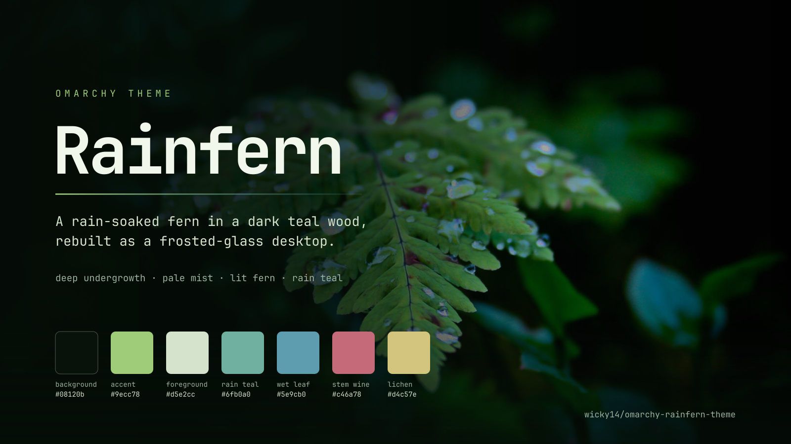

# Rainfern

A rain-soaked fern in a dark teal wood, rebuilt as an Omarchy theme: deep
undergrowth surfaces, pale-mist text, lit-fern green, and frosted glass over the
photograph that inspired it.



## Install

```sh
omarchy theme install https://github.com/wicky14/omarchy-rainfern-theme
omarchy theme set rainfern
```

## Update

```sh
omarchy theme update
```

## Remove

```sh
omarchy theme remove rainfern
```

## The theme

- Dark forest palette taken from the wallpaper: near-black undergrowth, pale
  mist text, lit-fern green, rain teal, wet-leaf blue, stem wine and lichen gold.
- Frosted shell surfaces: the bar, popups, menus, launcher, notifications and
  polkit card are translucent, so Hyprland blurs the wallpaper through them.
- Terminals at 65% opacity with compositor blur.
- Yaru-sage icons, matching btop and Chromium colours.

The lock screen stays almost opaque on purpose, so a locked session does not
show the windows behind it.

### Glass

The frosting needs Hyprland blur and Omarchy's glassy modes:

```sh
omarchy hyprland window transparency glassy
omarchy bar background glassy
```

To make the surfaces more or less frosty, edit the `background-alpha` values in
`shell.toml` and re-apply the theme with `omarchy theme set rainfern`.

## Palette

| Role | Colour |
| --- | --- |
| Background | `#08120b` |
| Foreground | `#d5e2cc` |
| Accent | `#9ecc78` |
| Rain teal | `#6fb0a0` |
| Wet leaf | `#5e9cb0` |
| Stem wine | `#c46a78` |
| Lichen | `#d4c57e` |

## Wallpaper

The wallpaper is *Fern with water drops* by **snowarc**, downloaded from
[Wallhaven](https://whvn.cc/3lvg39). It is the property of its author and is
**not** covered by this theme's MIT license. If you are the author and would
like it removed, open an issue.

## License

[MIT](LICENSE) © 2026 wicky14
